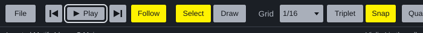

# Review against Apple's Human Interface Guidelines: Foundations

Miderator checked against all nineteen Foundations pages of Apple's Human
Interface Guidelines, as supplied by the user in October 2026 (the pages are
dated June 2026). Transient Shuffler was checked the same way the same day,
and Noterator alongside this ([its review](https://github.com/KallumS/Noterator/blob/main/docs/apple-hig-review.md));
the window's chrome, the side tabs and the Generate tab are the same code.
The reasons are in [decision 0048](decisions/0048-apples-human-interface-guidelines.md).

Miderator is a real Mac app, so unlike Transient Shuffler it can reach the
Mac's own alerts, title bar, accessibility settings and VoiceOver. It draws
its own controls in the house colours (0015) rather than Apple's, so each
guideline about colours, focus and names had to be met by hand.

## What changed

| Guideline | Before | Now |
| --- | --- | --- |
| **Accessibility, Dark Mode: contrast** (at least 4.5:1, 7:1 for small custom text) | Secondary text was 4.7:1; a track's instrument, under its name, 3.7:1 on the chosen track; an error from a generator was written in the house red at 3.4:1. | All secondary text is at least 7:1 on the ground and a track's instrument at least 6:1, dark or light. Errors are written in a lighter red (7.5:1); the house red still marks notes. |
| **Color: work in increased contrast** | Ignored the Mac's Increase Contrast. | With Increase Contrast on, secondary text, rules and outlines get stronger. |
| **Accessibility, Motion: Reduce Motion** | Follow scrolled the view smoothly while it played, whatever the setting. | With Reduce Motion on, Follow turns a page at a time; the Play menu says why. |
| **Accessibility: the keyboard alone** | After clicking a button or the grid menu, the keyboard stayed on it: Return clicked it again, and the arrows changed the grid instead of moving notes. Choosing a side tab did the same. As the window opened, the keyboard went to the window itself until something was clicked. Nothing showed which control had the keyboard. | Clicking leaves the keyboard with the roll, and the roll has it from the start. **Tab** and **Shift+Tab** go from the roll through every control and back, each wearing a light ring, scrolling a setting into view; **Space** or **Return** presses it; **Esc** goes back to the roll. **Cmd+1, 2, 3** choose the Generate, Blocks and Parts tabs. The volume slider moves with the arrows. |
| **Accessibility: VoiceOver; Icons: alternative text** | Buttons read "M", "S", "^", "v", "x", "-"; a degree in Blocks read "degree"; the grid and the settings' menus had no name; the tracks and the roll said nothing. | Every control has a name ("Mute", "Move Up", "Remove", "Zoom Out", "Grid", "ii, D", "Pace"); toggles say whether they are on, Select and Draw which is chosen; each result reads its title and size; the tracks and the roll are described ("String Quartet: 4 parts, 16 bars. Violin I in the roll, caret at bar 1 beat 1."); a new status message is read out. |
| **Layout (macOS): nothing important at the bottom of a window** | The status line, with the mode and every message, ran along the bottom edge; so did Add instrument, Blocks' Play and Insert, and the Generate message. | The status line is under the toolbar. Add Instrument is at the top of the Parts tab, Blocks' Play and Insert sit above the preview, and the Generate message is under its buttons. |
| **Accessibility, Typography: text up to 200%** | Fixed sizes. | **View** > **Interface Size**: 100%, 125%, 150%, 175% or 200%, remembered. The toolbar folds into two rows when it runs out of room, and the window can be smaller so 200% fits a laptop. |
| **Typography: keep truncation to a minimum** | The status message was cut short to keep room for the synth's name. | The message comes first: the synth's name goes, then the caret moves over, before the message is cut. The whole message is the line's tooltip. |
| **Design principles: familiarity; Writing: delivery** | Remove part used the Mac's alert, but every other question and error was drawn by the app, with OK left of Cancel. | Questions and errors are the Mac's own alerts, in its words ("Do you want to save the changes you made to...?"), Remove's button says Remove. Where the app asks for something itself (tempo, title), Cancel is on the left and OK on the right. |
| **Familiarity: build on what people know** | The title bar read "* String Quartet - Miderator". | As a Mac document: the song's name, a dot in the close button while there are unsaved changes, and the file's icon beside the name. |
| **Accessibility: control size** (20 points at the least) | A track's M and S were 20 by 16. | 22 by 20, with more room between them. |
| **Writing: capitalization** | Menus mixed "Step input from a MIDI keyboard" and "Step Input from a MIDI Keyboard", buttons "Add instrument...". | Menus and buttons in title case, with a real ellipsis (…) after commands that ask something first; labels and messages in sentence case. |
| **Icons; Familiarity** | Move up, move down and remove were the letters ^, v and x. Play was a word. | Drawn chevrons and a cross; Play has the triangle and Stop the square. |
| **Color, Accessibility: more than colour alone** | A note an instrument cannot reach was only red in the roll. | It also gets the red corner mark, as a chord too wide or too fast already did. |
| **Color: one colour, one meaning** | - | The keyboard's ring is the text colour, so yellow still only means on, chosen or sounding. |
| **Writing: errors near the problem, saying what to do** | "The generator failed - this is a bug, please report it"; "Could not save" with only a path. | "Nothing came back. Try other settings; if it keeps happening, please report it"; saving and exporting suggest another folder or checking the disk has room. |
| **Writing: clear next steps in empty places** | The results list was blank until something was generated. | "Press Generate to make some ideas, then click one to hear it." |
| **Writing: be accurate** | The Generate button's tooltip promised a G key (G writes a note) and Insert promised Return (it did nothing). | Return inserts the chosen result; the G is gone from the tooltip. |

## Already met

- **Purpose and simplicity.** One window for one job; the rarely used
  settings live in the File button's menu (0037-0039) and the side tabs.
- **Agency.** Undo and Redo for every edit; generated music never
  overwrites what it came from (0011); removing a part asks first and Undo
  brings it back; quitting with unsaved changes asks.
- **Feedback.** Hover and press states on every control; unavailable
  controls dimmed, not hidden; the sounding notes and the playhead in
  yellow; the status line says what each action did.
- **Alternatives to gestures.** Moving a note by dragging has the arrow
  keys; zooming has Cmd+= and Cmd+-; drawing has step input from a MIDI
  keyboard; quantising has Q. Stretching a note and choosing bars are still
  done with the mouse.
- **Control size.** Every other control is at least 24 points tall
  (Apple's minimum is 20; the toolbar's are 32).
- **Keyboard shortcuts.** The Mac's own (Cmd+Z, Cmd+S, Cmd+O...) work as on
  every Mac; none is overridden.
- **Writing.** Plain words, no "we", buttons named with verbs.
- **Privacy.** Nothing is collected or sent anywhere. The app asks for no
  permission (not the microphone); it keeps only its own settings
  (light or dark, zoom, Follow, interface size) in Application Support.
- **Branding.** No logo inside the window; the name is in the title bar
  only.
- **Dark Mode.** Apple advises against an app's own light/dark setting. The
  window's chrome is always dark, which Apple allows for apps built around
  media. Light stays: it is the colour of the tracks and the roll, the
  document, as Pages' own "dark background for documents" is.

## Not done

- **The app icon** is a picture with its corners already rounded. Apple's
  newest icons are layers put together in Icon Composer, which runs only on
  a Mac. Recorded for when the app is built in Xcode.
- **VoiceOver reading the notes one by one.** The tracks and the roll are
  one element each, described in words. A track's M and S are drawn, so
  VoiceOver cannot reach them; the Parts tab's Mute and Solo do the same.
  Moving and transposing by keyboard work without seeing the roll.
- **Nothing here was tried with VoiceOver or Full Keyboard Access on a
  Mac**: the names VoiceOver would read were checked by the tests, and the
  keyboard on Linux.
- **Right to left.** The window is in English only.

## Not relevant

Materials (Liquid Glass), Images, Spatial layout and Immersive experiences
(visionOS), SF Symbols (JUCE draws its own; the few icons are drawn to
match their weight).

## Checked by

- `Tests/TestWindow.cpp`: the contrast of every text colour in both
  contrast settings, and the tracks and the roll light and dark; every
  control in the toolbar and the side tabs has a name VoiceOver can say and
  leaves the keyboard with the roll; the toolbar in one row and two; Reduce
  Motion; the view in words.
- The app driven headless: Tab, Space and Esc; the side tabs keeping the
  keyboard with the roll; the rendered roll, light and dark.
